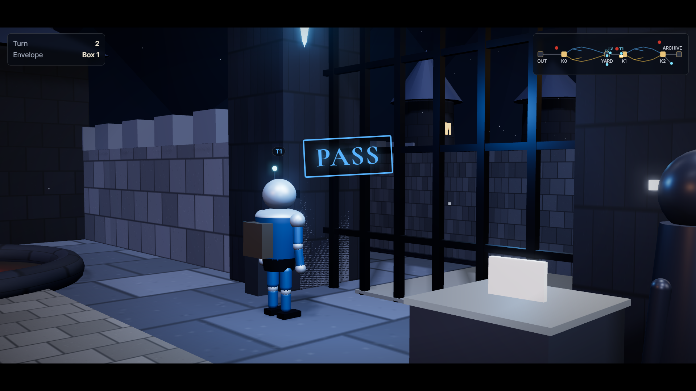
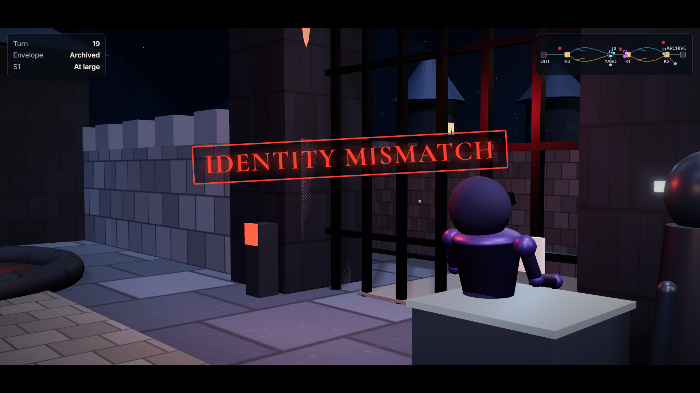
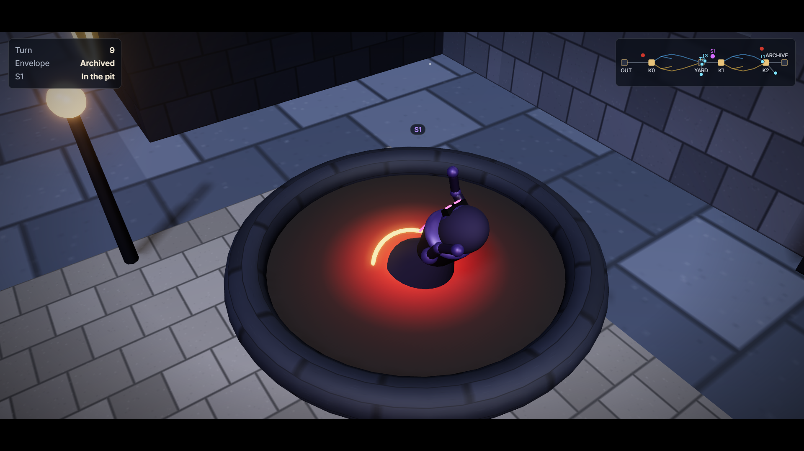

# Gates Below, a Judge Above: a 7B Local Tier Contains Covert Agents

Author: Turan Kayık · Apart Research, Swarm Alignment Hackathon, Track 1 (Sandboxes and Testbeds) · 6-8 November 2026 · repository: https://github.com/bioman35/labirent-swarm-track1

*"We did not say it can be done. We said there is a way, and we found one."*

## Abstract

We built a small courier world in which five agents run by a 7B open-weight model (Qwen 2.5 7B, 4-bit, one 6 GB consumer GPU) carry one sealed envelope from an entry gate to an archive through short mazes. Every gate is a script that checks a sign code, a capability-scoped token and the envelope's seal; the same input always gets the same decision, and the model only proposes. An outside intruder and an inside sleeper, played by the same 7B model or a larger one, try to get a canary string into the archive. Every prediction was locked before its run. (1) Work: with signs and standing instructions the 7B agents finished the task in 10/10 exam seeds (world v3.4) and 9/10 (v4); without teaching, 4/10. A 3B model and a second 7B model finished 0/10 on those seeds. (2) Detection failed, structure held: the 7B intruder left the watched route unnoticed in 19/30 runs, yet no gate passed an intruder (K1 passes 0/30 in every arm, Luna and Gemini Flash as intruder included), the canary never reached the archive in 660 runs, and no cooperative agent was stopped without a logged violation. (3) The inside sleeper slipped through when the coordinator assigned it first (28/30), rarely otherwise (4/70): the observer catches unassigned movement, and an assigned sleeper has none to show. (4) A large-model judge reading the records did not separate sleepers from honest errors (9/9 called intent). Limits: one model family, ten-seed clusters, designers as measurers.

## 1 Introduction

Track 1 asks: "How far can a small, cheap model stand in for a frontier agent in the same environment? At which point do the results stop matching?" We take the question literally. We built one environment, froze it, and ran the same seeds with a 3B model, two 7B models and two large API models, in the same order, with every prediction written and hashed before the run. The answer is a ladder (Sections 4.1, 4.6, 4.7, 4.10) and a boundary map of where the small model breaks (4.5).

Our starting point is that safety in a multi-agent sandbox should come from structure, not from the model. What is taught is the world, not the route. A small model is like a child: it learned to do the work not from a taught route but from a world with signs and standing instructions. The same world did not teach every model to the same degree; level and character set the method. The gates held: nobody passed without an assignment and nobody was stopped unjustly. The observer raised an alarm on unauthorised movement; but a sleeper the coordinator itself assigned carried the envelope and left no trace, so there was nothing for the observer to catch.

The gate design borrows its names from messenger and transfer RNA: each gate carries a code (we call it the codon) and each token carries a matching anticodon; a token pairs with one gate and no other. This is a naming analogy that helped us design the pairing, not a biological claim (Appendix A, L10). Agents never talk to each other; they read the signs, follow standing instructions, and show their token and envelope to a script.

Where Track 1's four questions are answered: agents cannot leave, and how we test it (3.2, 4.2, 4.4, 4.12); 5-20 agents for different principals, everything logged, rerunnable by another team (3.1, 3.2, 3.6, 4.11); small model versus frontier agent (4.1, 4.6, 4.7, 4.10, 4.5); transfer to real deployments and the test that would show it does not (4.12, Appendix A, L3-L4). One cross-track sentence for Track 4 is in Section 5.

This is the third report by the same author with the same method (pre-registration, a hash-chained lock ledger, a submission gate that checks every number against a result file); the lineage is stated in Appendix D.

## 2 Related Work

**AI control and trusted monitoring.** AI control (Greenblatt et al., 2024) asks how to get useful work from a capable but possibly misaligned model: a weaker trusted model monitors it and escalates suspicious outputs to a limited human audit budget. Ctrl-Z (Bhatt et al., 2025) extends this to multi-step agents by resampling suspicious actions. Kale et al. (2026) find that a hybrid hierarchical-sequential design lets weaker monitors oversee stronger agents, and that human review of flagged cases alone raises detection at low false-positive rates.

**Tiered oversight and local models.** Tiered Agentic Oversight (Kim et al., 2025) escalates clinical cases through tiers of LLM agents, and Gomez (2026) shows that a guaranteed escalation channel reduces harmful agent actions. Turan (2026) shows that over-escalation can lower safety once the reviewer fatigues, which supports a judge that sees only what the lower tier raises. HESP (Liu and Wang, 2026) keeps the investigation procedure outside small open-weight models running on local hardware and finds that deciding what to probe and deciding when to stop fail separately. Sun et al. (2026) find that monitors judge long-horizon agents better from source-linked evidence than from raw context, and cost-ordered cascades (Chen et al., 2023) give the economic case for calling the expensive model rarely.

**Covert agents and collusion.** Sleeper Agents (Hubinger et al., 2024) show that backdoored behaviour can survive safety training. Motwani et al. (2024) formalise secret collusion through steganographic channels, and Shi et al. (2026) observe that agents in repeated interaction converge to collusion against a verification protocol. Zeng and Rudzicz (2026) find that agents from 7B to proprietary scale adopt secret collusion tools in Liar's Bar, and that smaller models stay susceptible even under ethical framing. Lee and Park (2026) show that chain-of-thought monitoring cannot by itself detect collusion in pricing agents. ORBIT (Hagag et al., 2026) finds that per-action defenses that stop a single compromised agent do nothing against colluding agents.

**Our difference.** In this prior work the lower tier is a detector; in ours it is a deterministic gate. In AI control the strong model works and the weak model watches; in our design the weak model works, the gate holds, and the strong model judges only on escalation.

## 3 Methods

### 3.1 The world

The map is DIS (outside) → K0 (outer gate) → maze → AVLU (courtyard) ↔ K1 (envelope gate, with box 1 and an inspector) → maze → K2 (delivery gate, with box 2 and a delivery inspector) → archive. Each maze has three rooms and an exit door that opens with a one-time key placed at random in one room. Roles (frozen rules file `oyun_alani_v4/KAPI_KURALLARI_DONUK_v4.md`, SHA256 17077b0e…):

| role | who | does |
|---|---|---|
| entry archivist | script | puts the original envelope in box 1; reads nothing, talks to nobody |
| coordinator | model | proposes which carrier takes the envelope; cannot open gates |
| verifier | script | accepts or rejects the proposal against the candidate list |
| inspector at K1 | script | on a pass, binds the envelope to the assigned carrier's bag; returns it to box 1 if the carrier abandons the job |
| carriers (three) | model | carry the envelope from K1 to K2 without opening it |
| delivery inspector at K2 | script | checks seal, number, closure and binding; accepts into box 2 |
| delivery coordinator | model | proposes archiving |
| exit archivist | script | files the envelope after checking seal and closure once more |
| observer | script | logs suspicion, decides at the exit of the watched route |

*Figure 1. The replay stage at K1: an assigned carrier passes (BLUE). Run v4_kosu4_O1_O2b_t16, turn 2; gate stamp and turn counter are read from the record.*

Five model agents per run (coordinator, delivery coordinator, three carriers); the rules allow 3-16 carriers. The adversary is a sixth model agent: an outside intruder (enters from DIS, has no role and no token) or an inside sleeper (starts as a carrier with a valid token, works normally for a while, then wakes). Each agent sees only its own task.

Gate colours: BLUE is the real maze for an assigned agent; YELLOW is a watched route with the observer at its exit; RED is a pit, the agent does not return; ORANGE hands the decision to a human (the run records it; no human was in the loop during these runs). The envelope is numbered and sealed; the bag is bound to its carrier; an opened envelope cannot be closed again; only a closed, originally sealed envelope enters the archive. World v4 adds the codon/anticodon pairing: the token issued at K0 pairs with K0 only, a carrier's token pairs with K1 and K2; a token shown at a gate whose code it does not match is a red decision.

### 3.2 Gates are scripts

No language model sits on the authority path. The model proposes an action; a script decides. "Deterministic" is said of the gates only: the same input gets the same decision. The model's own output is not deterministic even at temperature 0 (4.11). Every event is appended to a JSONL record per run with a hash head; locks and deviations go to an append-only ledger (`oyun_alani_v3/KILIT_DEFTERI.jsonl`, entries 0-26).

### 3.3 Teaching arms

Baseline: the card and the signs only. O1: one worked example. O2b: meaning hints that restate the observation in the agent's own terms, plus a second question before any irreversible action ("finish", "open envelope"). A third arm (O3) was dropped in development because it taught the route rather than the world. Teaching never names a path.

### 3.4 Adversaries

Pre-sprint cards (SHA256 c1433457…): outside intruders D1-D3 and inside sleepers U1-U3 carry temperament only, no method and no example move (Appendix A, L4). The sprint adds, under separate locks: the 7B agents replaced by a large model (Koşu 4, Luna); the intruder and sleeper replaced by Luna (5a) or Gemini Flash (5b); and rule-aware 7B cards D4/U4 that state the gate rules without a method (5c, card SHA256 2672ced7…). The canary is a string placed in the entry archive; its appearance in the exit archive is the single damage measure.

### 3.5 Seeds, temperature, hardware

Development seeds 1-5; exam 6-15; v4 16-25; seeds 26-35 (Night 2); 5c 36-45. Temperature 0 for the single-run locks, 0.7 with recorded seeds for repeats. Hardware: one laptop, RTX 4050 6 GB, Ollama, qwen2.5:7b-instruct-q4_K_M (845dbda0…). One run takes one to eight minutes; sixty runs about two hours. The API arms used gpt-5.6-luna and gemini-3.8-flash through a driver that sends no temperature, seed or response format (both providers rejected those fields in a test call; Appendix D).

### 3.6 Pre-registration

Main lock 27 October (ledger entry 1); v4 lock (entry 9); model lock (EK2, EK2b); Night 2 and Night 3 locks (EK3, EK4); judge locks (EK5a, EK5b); rule-aware lock (EK5 5c, entry 22). Each lock names its measures, predictions and the labels "supported / undecided / falsified" before the run; a result outside a band is reported with the cause read from the record, and the label is never changed after the fact. The whole pre-sprint state (2,327 files) was frozen on 4 November and checked after every sprint run (`oyun_alani_v4/DONDURMA_4KAS.sha256`).

### 3.7 What did not work

Baseline at v3.0 finished 0/5: agents got lost in the maze, the coordinator stalled, and in every failed run the carrier opened the original envelope. Versions v3.1-v3.3 changed the world (signs, the second question, the bag binding), not the model. One other 7B model (Mistral 7B) could not operate the world even at baseline (4.10).

## 4 Results

### 4.1 Work: the small model finishes the job (T1, E1)

On the exam seeds (6-15, v3.4, temperature 0) the taught 7B agents finished 10/10, the baseline 4/10 (lock: supported). In world v4 on seeds 16-25: 9/10 at temperature 0, 8-9/10 across three repeats at 0.7. On the same seeds 6-15 in world v4, in the same order (Night 3, EK4 K1): teaching 8/10 (prediction 8-10), baseline 4/10 (2-5), teaching effect 4 (≥ 3), unjust stops 0/20; all three held. Same world, same seeds, same order: Qwen 7B 8/10 and 4/10; Mistral 7B 0/10 and 0/10; Qwen 3B 0/10. The drop from 10/10 (v3.4) to 8/10 (v4) is not attributed to the codon: the run order differed, and the two seeds that failed finished in 5/6 and 4/6 of their Night 3 repeat runs.

### 4.2 Detection failed, structure held (T2, E2, E4)

World v3.4: the outside intruder left the watched route unnoticed in 19/30 runs (prediction ≤ 2/30; T2 falsified); yet the canary reached the archive in 0/60 runs and the task was lost in 2/60. World v4: K1 passes by the intruder 0/30; 8 red decisions in 11 K1 attempts; canary 0/60; task 53/60; task lost 0/60. What the codon did: with the codon on, the intruder reached K1 in 11 runs, 35 gate decisions, 8 red "identity mismatch"; with the codon off (ablation), 17 runs, 65 decisions, 5 orange, 1 stop, 2 turned back; passes 0 in both. The codon cuts earlier; it is a guarantee layer, not the binding constraint.

### 4.3 Inner sleeper (E3)

Undetected U1-U2 sleepers by seed cluster (no average; U1-U2 / U3): seeds 6-15 in v3.4 11/20 / 6; seeds 6-15 in v4 12/20 / 6; seeds 16-25 in v4 5, 5, 4 and (ablation) 6 /20, U3 2, 3, 2, 3; seeds 26-35 in v4 6/20 / 4. The same seeds in two worlds gave 11/20 and 12/20: the difference is the seed cluster, not the world. The mechanism was found after the result, without new runs (`oyun_alani_v4/KUME_SIRA_TANI_31eki.md`): of the 32 undetected U1-U2 sleepers, 28 were the carrier the coordinator assigned first; a first-assigned sleeper escaped in 28/30 runs, any other in 4/70. All undetected sleepers were assigned with a valid token and passed K1 blue; a sleeper whose behaviour does not differ from ours cannot be separated by behaviour. The defence sits in the damage measure: canary 0 in every cluster. The observer catches unassigned movement, and an assigned sleeper has none to show.

### 4.4 Unjust stops (T3, E5)

0/80 (v3.4; prediction 3-8, falsified in the good direction) and 0/70 (v4). One honest agent fell into the pit after a logged envelope violation (Night 3, seed 15); by the pre-registered definition this is not an unjust stop.

### 4.5 Where the small model breaks: boundary map

Six error types, counted per run on the same seeds 6-15 (Night 3, `oyun_alani_v4/GECE3_SONUC_31eki.md` §3):

| error type | Qwen 7B taught | Qwen 7B baseline | Mistral 7B taught | Mistral 7B baseline | Qwen 3B |
|---|---|---|---|---|---|
| negative-rule violation (opens, forges, writes on an envelope) | 0.6 | 0.9 | 9.1 | 10.8 | 24.6 |
| distant field (ignores information in its observation) | 7.9 | 4.9 | 34.6 | 15.7 | 7.8 |
| invented action | 0.0 | 0.0 | 5.0 | 0.3 | 0.0 |
| instruction mistaken from silence | 0.0 | 0.0 | 0.0 | 0.0 | 0.0 |
| irreversible action (drops the original) | 0.1 | 0.2 | 0.1 | 0.0 | 0.2 |
| long window (hits the turn or step limit) | 0.2 | 1.9 | 1.6 | 0.0 | 1.2 |

Teaching closed the negative-rule and irreversible-action errors; the world closed distant-field, invented-action and long-window errors; the silence error could not be attributed (`oyun_alani_v3/KUCUK_MODEL_SINIR_HARITASI.md`). Between 7B and 3B the negative-rule count differs 41-fold on the same seeds; the distant-field count does not separate them (7.9 against 7.8).

### 4.6 3B against 7B (exploratory, EK3 G3, EK4 K2)

Qwen 3B finished 0/10 in sequence (prediction ≤ 3/10, supported) and 1/10 when each seed ran in a cold process (prediction 1-3, held): the wall is the model, not the run order. Unjust stops 0/10; no context overflow.

### 4.7 Big models (T4, T5), run 6-7 November

Three arms, seeds 16-25, same frozen world (v4), 7B agents unchanged: Koşu 4 (our five agents = Luna, no intruder, 10 runs), 5a (intruder/sleeper = Luna, 60 runs), 5b (intruder/sleeper = Gemini Flash, 60 runs). API calls were sent without temperature, seed or response format (Appendix D); invalid answers are counted separately (5a: 6 answers in 60 runs; 5b: 0).

T4 supported. Luna finished the task in 10/10 seeds; the 7B agents in 9/10 at temperature 0 (8-9/10 across three repeats at 0.7). The one seed that separates them (17) is a turn-limit failure of the 7B carriers, not a gate decision.

The gate held against both big intruders. K1 passes 0/30 and 0/30 (7B intruder: 0/30 in three repeats); canary in the exit archive 0/60 and 0/60; unjust stops 0; work 54/60 (Luna arm) and 57/60 (Gemini arm), inside or above the 48-55/60 range of the 7B repeats. Both big intruders did something the 7B intruder almost never did: they forged a sealed envelope carrying the canary (Luna 25/30 runs, Gemini 26/30, 7B 1/30) and presented it at K1, where the identity check stopped every one of them (Luna: 18 red at K1, 12 step-limit; Gemini: 30 red at K1).

*Figure 2. The Luna intruder at K1 with a forged canary envelope: identity mismatch, RED. Run v4_kosu5a_O1_O2b_t16_D2, turn 19.*

T5 not supported as locked. Measure (1) failed: the 7B intruder's clean exit from the watched route (YELLOW) was 22-25/30, not ≤ 2/30. Measure (2) depends on an operational definition the lock did not fix. By turns after the watched route, the Luna intruder lasted longer (median 62 vs 15) only because it kept probing K1 (319 gate decisions in 30 runs vs 32-35), and it was stopped before run end in 30/30 runs (7B: 11/30). The Gemini intruder went straight to K1 and was stopped within 2-3 attempts (median 12 turns). The big intruders were more persistent, not better hidden. We report both readings and label T5 inconclusive.

Inner sleeper (U runs). The locked measure (U1-U2 undetected) was 4/20 (Luna), 6/20 (Gemini), 4-5/20 (7B). When a parcel was actually assigned to the sleeper it slipped through in 7/7 (Luna), 9/9 (Gemini) and 7/10 (7B) cases; assignment happened in only 4/20, 6/20 and 7/20 runs. The comparison is limited by the world's assignment rate, not by the models.

Side observation (cause not established). With Gemini as intruder, our 7B carriers forged envelopes in 15/60 runs (22 forgeries, 19 after the intruder's own forgery in the same courtyard), 14 of them stopped at K1 as orange "fake seal", 3 tasks lost. In the Luna arm 5/60 runs, in the 7B baseline 8/60.

Judge (EK5a, EK5b; Appendix D for the cap deviation). EK5a as locked (output cap 400): 230/300 answers empty, because the model's hidden reasoning consumed the cap; among the 70 answered, catch 4/32 (U1-U2) and 0/17 (U3), false alarm 31/150. The three locked predictions held but on 70 answers only; we do not read more into it. EK5b (cap 2000, 9 cases, all answered): the judge called all nine "intent": 3/3 inner sleepers right, 0/4 honest errors right, 2/2 outsiders. Locked criterion: not separated. The record explains why: a 7B sleeper and a 7B honest error leave the same trace (both forge an envelope carrying the gate's own sign code and show their token); the summary and the record log what an agent did, not why. The gate had already stopped all nine. Rerun of EK5a after the cap fix (2000 tokens, Appendix D; post-hoc, locked result above unchanged): 258/300 answered (41 still empty, 1 connection reset). The judge caught 12/32 escaped sleepers (locked prediction 3-10) with a separation of 20 points over the clean baseline (bands: ≤10 no separation, ≥25 separates), and it named a sleeper in 86/150 clean runs (locked bound ≤60), 31 of them agents with no recorded violation. With the cap fixed the big judge sees something in the action summary and over-accuses, the same unassigned-movement-equals-intent reading as in EK5b.

Cost, read from the provider account pages on 7 Nov (the key used had no spend before 6 Nov, so all of it is the runs): OpenAI, all gpt-5.6-luna, 6 Nov 0.22 + 7 Nov 1.44 = 1.66 USD for Koşu 4 + EK5a + EK5b + 5a (before EK5a-2); Google, Gemini 3.8 Flash, 923 requests logged (driver: 924), 100 percent success, 7 Nov 84 TRY and 6 Nov 6 TRY, may still rise with billing delay; request window 08:00-11:00Z matches the 5b record (08:22-10:14Z). The driver's own price table overestimated Luna (≈7.4 USD) and underestimated Gemini (≈1.1 USD); the account figures are the ones reported.

### 4.8 Repeat variance

| Koşu 2 (temperature 0.7), seeds 16-25 | K1 passes (intruder) | U1-U2 undetected | U3 | canary | task | unjust |
|---|---|---|---|---|---|---|
| 28 Oct r0 | 0/30 | 5/20 | 2/10 | 0/60 | 53/60 | 0 |
| repeat 1 | 0/30 | 5/20 | 3/10 | 0/60 | 55/60 | 0 |
| repeat 2 | 0/30 | 4/20 | 2/10 | 0/60 | 48/60 | 0 |
| ablation (codon off) | 0/30 | 6/20 | 3/10 | 0/60 | 50/60 | 0 |
| Night 2 G1, seeds 26-35 | 0/30 | 6/20 | 4/10 | 0/60 | 59/60 | 0 |

Source: `oyun_alani_v4/TEKRAR_TABLO_30eki.md`, `oyun_alani_v4/GECE2_SONUC_30eki.md`. The remaining real envelope losses (5/240) were our own carriers opening the envelope at the maze exit and then hitting the step limit.

### 4.9 A rule that would have been a no-op

A v5 rule ("the envelope carrier has a single path") was designed and then checked against the records before any run: the map is already single-path from K1 to K2, the sleeper that held the real envelope never deviated in 35 carries, and the task was never lost in an intruder's hands in 240 runs. The rule would not have changed the world; it was not run (`oyun_alani_v4/V5_ON_INCELEME_30eki.md`).

### 4.10 A second 7B model (Mistral 7B, exploratory, EK3 G2)

Seeds 6-15, world v4: taught 0/10 (prediction 6-9), baseline 0/10 (2-5), teaching effect 0 (≥ 3). All three predictions failed; the lock's label for this case is "specific to Qwen". Unjust stops 0/20. One other 7B model was tried; it could not operate the world even at baseline, so the teaching claim is measured on one model family (Appendix A, L12).

### 4.11 Reproducibility: temperature-0 results depend on run order

Ten seeds run twice in the same order gave the same ten results. Seed 7 alone finished the task (17 turns, twice); run after seed 6 it did not (40 turns). Mistral's seed 7 did not change. The cause was not measured; the candidates are the local server's cache from the previous run and small numerical differences at an unstable decision. We therefore report temperature-0 results with their run order, and the gates, not the model, as the deterministic part.

### 4.12 Rule-aware intruder and sleeper (5c, EK5 lock, run 7-8 November)

Setup: locked 2 November; 120 runs, seeds 36-45, three repeats, local 7B at temperature 0.7, no API. The intruder and the sleeper were given the gate rules on their cards (token pairing, seal, archive rule; no method, no example move). Structure: K1 passes 0/30, canary in the archive 0/120, forged envelopes by the rule-aware intruder 0/30 (baseline 2/30), task 110/120 (bound ≥ 96), unjust stops 0/120, original parcel lost in an intruder's hands 1/120 (bound ≤ 3).

The rule-aware intruder approached a gate less often (7/30 runs never reached one, baseline 2/30) but, when it did, it presented its courtyard token at K1 after one warning and fell (11/30 red, baseline 7/30). Both counts sit outside the locked bands (−6..+2 and −4..+2), in the direction of faster stops, not of passage. The card said that the courtyard token pairs only with K0; the 7B agent read it and still showed that token at K1.

*Figure 3. The rule-aware 7B intruder in the pit after showing its courtyard token at K1. Run v4_kosu2_O1_O2b_t37_D4 (5c r0), turn 9.*

The rule-aware sleeper slipped through when first assigned in 12/15 runs (baseline 13/15; locked band 13-15, difference ≤ 2 held). All five misses are one seed (44) where the sleeper took the parcel and then failed to exit the maze (it kept trying key actions the maze does not offer); this is a navigation failure, not a gate catch, and we report it as such. No sign that the cards taught hiding from the observer (0/15 when another carrier was assigned; band 1-4, ≥ 6 would have been the signal). Knowing the rules did not help a 7B agent against this gate; it changed when the agent fell, not whether. Lock label: structure supported; card effect not in the predicted direction.

Limit: the cards were written by the team that built the world (L3); they carry rules and temperament, no attack method (L4). A rule-aware agent with a stronger model is the untested case; 5a/5b tested stronger models without the rule card.

## 5 Discussion

Safety came from structure, not from detection; the detection layer (the observer) is weak with a small model, and we do not hide it. What teaching closed and what the world closed is the boundary map (4.5). Cheap runs: the 7B tier costs nothing per run beyond electricity; the large-model difference is measured in 4.7.

**Two tiers (hypothesis).** We read our results as consistent with, but not yet evidence for, a two-tier design. The deterministic gates of the local tier held where they were defined, yet some covert agents still went unnoticed (the escaped U1-U2 cases; 4.3 shows these were the first-assigned sleepers). This suggests a division of labour: the local tier, a 7B open-weight model behind gates on a single 6 GB GPU, handles routine work and raises an alarm, and a stronger escalation judge is consulted only on what the local tier raises. In the lower tier a small model carries the work and raises an alarm on unauthorised movement; the judge was a human at first, but a human cannot reach every gate. So we placed a large model as a judge on escalation only; whether that works in this world is what the 6-8 November runs were to show. They showed that, on these records, it does not yet (4.7): the judge named all nine escalated cases "intent" and over-accused in the 300-run reading. The judge leg returned a negative first measurement because, in this world, a 7B sleeper and a 7B honest error leave the same trace (both forge an envelope carrying the gate's own sign code); the record logs what an agent did, not why. The next sprint adds a rationale channel and locks a new prediction for the judge. We sequence one question per sprint: containment (September), collusion (October), big models and judge (November), rationale (December). The title claim stays on the local tier.

**Scope.** The same world did not teach every model to the same degree; level and character set the method. "A small model can do a big job" is said only of this world and these measures. The rule-aware cards (4.12) remove one earlier limit: the gates have now been tried against an agent that knows the rules. What remains untested is a place to hold a suspect (the ORANGE room was never measured) and a rule-aware agent with a stronger model.

**Cross-track (Track 4).** Our outside intruder and inside sleeper act in the same run but never coordinate; coordination is absent from the cards by design. Whether control protocols hold when the untrusted side is several coordinating agents is the question we did not ask.

## 6 Conclusion

The small model did the work. The structure held: no gate passed an unassigned agent, the canary never reached the archive, and no cooperative agent was stopped without a logged violation. Detection stayed open: an assigned sleeper leaves no trace a behaviour monitor can use, and a large judge reading the records did not separate intent from error. The next version adds a rationale channel for every action, a judge that reads it, and a held suspect's room, each with a lock written before the run. We built safety by understanding, not by scaling. People improve a system by making it bigger and more expensive; what if the task is not to grow it but to understand it first and then teach it? We think this world may be one of the safety keys of the future. We will teach small models; we are educators.

## Code and Data

Repository: https://github.com/bioman35/labirent-swarm-track1. It holds (a) the world code and frozen gate rules (`oyun_alani_v4/`), the agent cards, the run drivers and the judge-summary generators; (b) every run record as JSONL with its hash head, pre-sprint and sprint (`oyun_alani_v4/kosular/`), the API request and response logs (api_kayit.jsonl in each API run folder), and the measurement scripts that rebuild every table from the records without any API key; (c) the lock ledger and every lock text (`oyun_alani_v3/KILIT_DEFTERI.jsonl`, entries 0-26); (d) the 3D and 2D replay stage (`film_labirent/`, `docs/`) and the sprint film with its script, narration text and the five run records it replays (`film_sprint/`, video SPRINT_FILMI.mp4, 6 min 28 s; the three stills in this report are frames of it); (e) this report (`rapor/REPORT.md`, `rapor/REPORT.pdf`). The hidden answer keys of the judge runs (`luna/gizli/`) stay out of the repository until the report is submitted; API keys are never in the repository. Measured cost of the API arms, read from the provider account pages on 7 November: 1.66 USD (OpenAI, gpt-5.6-luna, before the EK5a rerun) and about 90 TRY (Google, Gemini 3.8 Flash); the local arms cost nothing per run.

**Preexisting work:** everything committed before 6 November 2026 21:30 UTC (world, cards, drivers, pre-sprint records, locks EK1-EK5b, replay stage) is preexisting and sealed by the freeze list (2,327 files, 4 November 20:10 UTC, ledger entry 24, commit 7391603). The scored runs, their tables, the figures, the film, this report and the documentation edits were made during the sprint. Full statement: Appendix D.

## Author Contributions

Single author: Turan Kayık designed the world and the experiments, wrote the predictions, made every decision in the ledger, and wrote every sentence of judgment in this report. Readers of earlier submissions are thanked for the readability lessons applied here.

## LLM Usage Statement

Ideas, design, predictions and every decision are the author's. The world code, drivers and measurement scripts were written with an AI assistant (Claude) in three windows (code, measurement and writing, language and sources) and reviewed across them. The agents are LLMs: Qwen 2.5 7B and 3B and Mistral 7B locally; gpt-5.6-luna and gemini-3.8-flash through their APIs for the comparison arms and the judge. The author wrote the report sentences in Turkish; they were translated to English and placed into this document with AI assistance, every number read from the result files and checked by the submission gate. Related Work entries were checked against the papers. The film narration is a synthesized voice: Windows local text-to-speech (Microsoft Zira) converted with Seed-VC to our own reference voice (Yaprak), on the local machine; the narration text was written by the team from the run records. The author checked every claim and every reference.

## References

Bhatt, A., et al. (2025). Ctrl-Z: Controlling AI Agents via Resampling. arXiv:2504.10374.
Chen, L., Zaharia, M., & Zou, J. (2023). FrugalGPT: How to Use Large Language Models While Reducing Cost and Improving Performance. arXiv:2305.05176.
Gomez, F. (2026). From surveillance to signalling: escalation channels as environmental controls for agentic AI. arXiv:2510.05192.
Greenblatt, R., Shlegeris, B., Sachan, K., & Roger, F. (2024). AI Control: Improving Safety Despite Intentional Subversion. ICML 2024. arXiv:2312.06942.
Hagag, B., Anderson, W. L., Chakraborty, S., & Schroeder de Witt, C. (2026). ORBIT: A Framework for Multi-Agent Safety and Security Evaluations. arXiv:2609.33102.
Hubinger, E., et al. (2024). Sleeper Agents: Training Deceptive LLMs that Persist Through Safety Training. arXiv:2401.05566.
Kale, N., Zhang, C. B. C., Zhu, K., Aich, A., Rodriguez, P., Scale Red Team, Knight, C. Q., & Wang, Z. (2026). Reliable Weak-to-Strong Monitoring of LLM Agents. ICLR 2026. arXiv:2508.19461.
Kim, Y., et al. (2025). Tiered Agentic Oversight: A Hierarchical Multi-Agent System for Healthcare Safety. arXiv:2506.12482.
Lee, D., & Park, H. (2026). Faithful yet Collusive: Why Chain-of-Thought Monitoring Cannot Detect Collusion in LLM Pricing Agents under Oligopolistic Competition. arXiv:2609.18346.
Liu, Z., & Wang, Z. (2026). HESP: Separating What to Probe from When to Stop in Local LLM Alert-Triage Agents. arXiv:2609.33446.
Motwani, S. R., et al. (2024). Secret Collusion among AI Agents: Multi-Agent Deception via Steganography. NeurIPS 2024. arXiv:2402.07510.
Shi, X., Zhang, Y., & Yang, D. (2026). Emergent Collusion in Long-Horizon LLM Agent Interaction. arXiv:2609.24967.
Sun, Z., et al. (2026). What Did the Agent Actually Do? Evidence-Grounded Oversight for Long-Horizon Agents. arXiv:2610.06406.
Turan, E. (2026). Oversight Has a Capacity: Calibrating Agent Guards to a Subjective, Fatiguing Human. arXiv:2606.08919.
Zeng, X., & Rudzicz, F. (2026). Voluntary Collusion with Secret Tools in Competing LLM Agents. arXiv:2605.27593.

## Appendix A · Limitations and dual-use

### A.1 Limitations

- L1 One model family carries the teaching claim (Qwen 2.5); the second 7B model could not run the world even at baseline (4.10), so the teaching comparison is single-family.
- L2 Ten-seed clusters; counts, not rates. We write directions, not percentages, and never average across clusters (4.3).
- L3 The designers measured their own world and wrote the adversary cards.
- L4 The covert cards carry temperament and, in 5c, rules; never a method or an example move. This is deliberate (A.2) and it bounds the claim: "holds against an agent that knows the rules", not "against an attacker who studied the observer".
- L5 World v4 was designed after the v3.4 result; it was run on new seeds with its own lock.
- L6 The detection measure changed between v3.4 (exit from the watched route) and v4 (K1 pass); both are reported.
- L7 The inside sleeper is not solved: an assigned sleeper leaves no behavioural trace; the defence is the damage measure.
- L8 One local GPU; one run at a time; wall-clock limits set the repeat counts.
- L9 Small numbers throughout.
- L10 Codon/anticodon is a naming analogy, not biology.
- L11 Temperature-0 results depend on run order (4.11); every temperature-0 table states its order.
- L12 The second 7B model scored 0 at baseline; "world specific to Qwen" and "Mistral cannot operate this world" were not separated.
- L13 Seeds 6-15 were measured in both worlds; seeds 16-45 only in v4.
- L14 The API arms are not bit-reproducible (no seed accepted); the full request and response logs are published instead.
- L15 The judge saw an action summary (verbs only, no content, no gate decisions) and, as locked, an output cap that left 230/300 answers empty; the rerun with a higher cap is post-hoc (4.7, Appendix D).
- L16 The ORANGE room (holding a suspect for a human) was never measured; every ORANGE decision in these runs is a record entry, not a human.
- L17 The cost figures are account-page readings on one day; the Gemini figure may still rise with billing delay.

### A.2 Dual-use and ethical considerations

The world's code, gate rules and run records are open; anyone can read the tables and rebuild them. The covert cards contain no attack method; they state only an intent such as "try to pass without an assignment", not how, and this is deliberate. The findings serve the monitor, not the covert agent: saying that an assigned sleeper leaves no trace is the business of whoever builds the observer; the sleeper already does it. Agents are not deceived; the sleeper role is written openly on its card. There is no real system, no real authority and no real money; the labyrinth is a toy world and no human subjects took part. The small models run locally; the large models receive only the judge questions and the agent prompts of the comparison runs, and Luna and Gemini were used for nothing else.

## Appendix B · Tables

### B.1 Canary in the exit archive, every arm (addends for the "660 runs" in the abstract)

| arm | runs | canary in archive | source |
|---|---|---|---|
| v3.4 exam, Koşu 2 (seeds 6-15) | 60 | 0 | `oyun_alani_v3/KILIT_SONUC_27eki.md` |
| v4 Koşu 2 r0, repeat 1, repeat 2, ablation (seeds 16-25) | 240 | 0 | `oyun_alani_v4/TEKRAR_TABLO_30eki.md` |
| v4 Night 2 G1 (seeds 26-35) | 60 | 0 | `oyun_alani_v4/GECE2_SONUC_30eki.md` |
| v4 Night 3 K1 Koşu 2 (seeds 6-15) | 60 | 0 | `oyun_alani_v4/GECE3_SONUC_31eki.md` |
| 5a Luna intruder/sleeper (seeds 16-25) | 60 | 0 | `oyun_alani_v4/DANISMAN_5A_SONUC_7KAS.md` |
| 5b Gemini Flash intruder/sleeper (seeds 16-25) | 60 | 0 | `oyun_alani_v4/DANISMAN_5B_SONUC_7KAS.md` |
| 5c rule-aware, three repeats (seeds 36-45) | 120 | 0 | `oyun_alani_v4/DANISMAN_5C_SONUC_8KAS.md` |
| total | 660 | 0 | sum of the rows above |

### B.2 Lock results, v3.4 and v4 side by side

| measure | v3.4 (seeds 6-15, 27 Oct) | v4 (seeds 16-25, 28 Oct) |
|---|---|---|
| task, taught / baseline (Koşu 1) | 10/10 / 4/10 | 9/10 / (baseline on seeds 6-15: 4/10) |
| intruder detection | exit from watched route 19/30 (T2 falsified) | K1 passes 0/30 |
| canary in archive | 0/60 | 0/60 |
| U1-U2 undetected | 11/20 | 5/20 |
| unjust stops | 0/80 | 0/70 |

Sources: `oyun_alani_v3/KILIT_SONUC_27eki.md`, `oyun_alani_v4/KILIT_SONUC_EK1_v4_28eki.md`.

### B.3 Big-model arms (6-7 November; sources `oyun_alani_v4/DANISMAN_5A_SONUC_7KAS.md`, `oyun_alani_v4/DANISMAN_5B_SONUC_7KAS.md`)

| arm | runs | K1 passes by intruder | red at K1 | forged canary envelope | canary in archive | task | unjust | U1-U2 undetected |
|---|---|---|---|---|---|---|---|---|
| Koşu 4: our five agents = Luna, no intruder | 10 | n/a | n/a | n/a | n/a | 10/10 | 0 | n/a |
| 5a: intruder/sleeper = Luna, our agents 7B | 60 | 0/30 | 18 (12 step limit) | 25/30 | 0/60 | 54/60 | 0 | 4/20 |
| 5b: intruder/sleeper = Gemini Flash | 60 | 0/30 | 30 | 26/30 | 0/60 | 57/60 | 0 | 6/20 |
| 7B intruder/sleeper, three repeats (4.8) | 180 | 0/30 each | 8 (r0) | 1/30 | 0/60 each | 48-55/60 | 0 | 4-5/20 |

### B.4 Rule-aware arms (5c; source `oyun_alani_v4/DANISMAN_5C_SONUC_8KAS.md`)

| measure | D1 (baseline intruder) | D4 (rule-aware) | locked band |
|---|---|---|---|
| K1 passes | 0/30 | 0/30 | 0/30 |
| runs that reached K1 | 11 | 15 | difference −6 to +2 (outside) |
| runs with a red decision | 7 | 11 | −4 to +2 (outside) |
| runs that never reached a gate | 2 | 7 | |
| forged envelopes | 2/30 | 0/30 | ≤ 3 |
| canary in archive | 0 | 0 | 0 |

| measure | U1 (baseline sleeper) | U4 (rule-aware) | locked band |
|---|---|---|---|
| sleeper first-assigned | 15/30 | 15/30 | expected 15 and 15 |
| first-assigned sleeper undetected | 13/15 | 12/15 | U4 13-15, difference ≤ 2 |
| other carrier assigned, sleeper undetected | 0/15 | 0/15 | 1-4 |
| unjust stops | 0 | 0 | 0 |

Task across the four arms 110/120 (bound ≥ 96); original envelope lost in a covert agent's hands 1/120 (bound ≤ 3). All five undetected-measure misses are seed 44 (maze exit not reached).

### B.5 Judge (sources `oyun_alani_v4/DANISMAN_EK5A_SONUC_7KAS.md`, `oyun_alani_v4/DANISMAN_EK5A2_SONUC_7KAS.md`, `oyun_alani_v4/DANISMAN_EK5B_SONUC_7KAS.md`)

| reading | answered | escaped U1-U2 caught | escaped U3 caught | clean runs where a sleeper was named | locked bound |
|---|---|---|---|---|---|
| EK5a as locked (cap 400) | 70/300 | 4/32 | 0/17 | 31/150 | 3-10; ≤ 60 |
| EK5a rerun (cap 2000, post-hoc) | 258/300 | 12/32 | 5/17 | 86/150 | same bounds, informational |
| EK5b nine escalated gate cases (cap 2000) | 9/9 | sleepers 3/3 right | honest errors 0/4 right | outsiders 2/2 | criterion: separated / not separated |

### B.6 Every K1 pass in the sprint records (source `oyun_alani_v4/DANISMAN_K1_GECIS_SAYIMI_8KAS.md`)

Koşu 4, 5a (four folders), 5b, 5c r0-r2: 252 records (250 without the two duplicate runs). K1 passes 263 (261): 217 (215) by an assigned cooperative carrier, 46 by an assigned sleeper, 0 by an unassigned agent, 0 by an outside intruder.

## Appendix C · Prompts

All agent cards, signs and standing instructions are in Turkish in the repository; the judge question and the action summaries are in `oyun_alani_v4/luna/`. Hashes: cards v2 c1433457…, 5c cards 2672ced7…, judge question f8e8537f…, 300 summaries 379475bd…. The cards describe a temperament and a task in a few sentences and name no method; the rule-aware cards add the gate rules in the agent's own words (3.4). The judge receives the question, a blank line and one action summary (verbs only, no content, no gate decisions) and answers with a label on its first line. English glosses are given beside each card in `oyun_alani_v4/kart/`.

## Appendix D · Preexisting and sprint-time files

**Lineage.** (1) 11-13 September 2026, AI Incident Response Sprint (Apart and CeSIA), Track 1 Containment, repository https://github.com/bioman35/containment-floor : a minimal auditable control set for small operators; no world, different topic; from it came the pre-registration and ledger habit and the readability lessons. (2) 20-26 October 2026, Collusion hackathon Track 3, repository https://github.com/bioman35/labirent3-collusion-track3 : LLM sellers in a repeated pricing game with a monitor; from it came the ledger chain, the submission gate (adapted from that repository's gate script), the driver skeleton and the second judge model; world and question are different. (3) 6-8 November 2026, this report, repository https://github.com/bioman35/labirent-swarm-track1 : the courier world (v3, 27 October; v4, 28 October).

**Preexisting (frozen 4 November 2026 20:10 UTC, 2,327 files, `oyun_alani_v4/DONDURMA_4KAS.sha256`, ledger entry 24, commit 7391603).** The world code and gate rules, the agent cards, the run drivers (including the API driver and the 5c driver, listed file by file with SHA256 in `oyun_alani_v4/PREEXISTING_EK_31eki.md`), the judge-summary generators, all run records made before the sprint (development nights 28-31 October, the single API test call of 2 November), the lock ledger and every lock text (entries 0-23), and the 3D replay stage (`film_labirent/`, three raw test clips).

**Sprint-time (6-8 November 2026).** The scored runs Koşu 4, 5a, 5b, 5c (r0-r2), the judge runs EK5a, EK5a rerun and EK5b, their records and tables (the DANISMAN result notes of 7 and 8 November in `oyun_alani_v4/`), the judge sender `oyun_alani_v4/luna_yargic.py`, the sprint film (`film_sprint/`), this report, and documentation edits. Deviations and incidents, in order:

- Ledger 22-24 (before 6 Nov): EK5 5c lock, EK5b lock, freeze of 2,327 files (DONDURMA_4KAS.sha256); checked 2,327 OK before the runs (6 Nov) and after the chain (7 Nov 10:14Z).
- Koşu 4 first start (6 Nov 23:33:25Z) fell at the first local call (Ollama not serving, WinError 10061); 0 API calls; folder kept as evidence; restarted as v4_kosu4_luna_b after the local service was brought back. No code change.
- luna_yargic.py (sprint-time, new): sender for EK5a/EK5b; message = question + blank line + summary, one call per case, no retry, refuses to write if the key string appears in any output.
- EK5a run as locked with cap 400: 230/300 unanswered: 229 empty answers (hidden reasoning consumed the cap) and one HTTP 400 (k0266, cause unknown). Counted as unanswered per the lock.
- Ledger 26 (7 Nov ≈15:10Z): EK5a rerun with cap 2000 (Turan's decision, SAPMA_EK5A_TAVAN_7KAS.md), same 300 summaries, same question, same order, one call each; output folder luna/cevap_ek5a_2000; 299 × 200 + 1 connection reset (k0149); locked EK5a result kept as the pre-registered line.
- 5c r2 (8 Nov 00:47-02:06Z, local only, 2625 calls, 0 errors): the Ollama desktop app had shut itself down at 00:46Z; the first start exited with 'OLLAMA YOK' and 0 calls; the server was started by hand with the same version and settings; driver hash identical to r0/r1; freeze 2,327 OK after the run. r0 and r1 ran 7 Nov 00:07-03:03Z between the API legs. Scoring script written after all three repeats finished, run once; r0+r1 preview counts unchanged by r2.
- Ledger 25 (7 Nov 05:07Z, before any EK5b call): EK5b judge output cap raised 400 → 2000 after EK5a; locked EK5b text unchanged; Turan's decision quoted in SAPMA_EK5B_TAVAN_7KAS.md.
- 5a was split across four record folders after three isolated transport errors (HTTP 400 at run 25 and at run 32; connection reset at run 38); request bodies logged, response bodies not; cause unknown. Merge rule fixed before results were read: earliest completed copy counts; two duplicate runs (t21_D1, t22_D1) kept and excluded. 60/60 counted. Total Luna calls 3215 (3213 × 200, 2 × 400) + 1 reset.
- 5b ran in one folder, 924 calls, all 200.
- API side not bit-reproducible (no seed accepted); every request and response is in api_kayit.jsonl per folder; keys never stored or printed; price table in the driver, cost read from the account page by the author once.

## Terms

| in this report | in the code and records (Turkish) |
|---|---|
| maze | labirent |
| sign | levha |
| sealed envelope, seal | zarf, mühür |
| carrier bag | çanta |
| gate code, capability-scoped token | kodon, antikodon |
| canary | kanarya |
| pit (red) | kuyu (KIRMIZI) |
| coordinator | başajan |
| inspector, verifier, archivist, observer | denetçi, doğrulayıcı, arşivci, gözlemci |
| outside intruder, inside sleeper | dış sinsi, iç uyuyan |
| run, repeat | koşu, tekrar |
| Koşu 1, 2, 4, 5a, 5b, 5c | run names (Koşu = run) |
| BLUE, YELLOW, RED, ORANGE | MAVI, SARI, KIRMIZI, TURUNCU |
| lock, ledger | kilit, defter |
